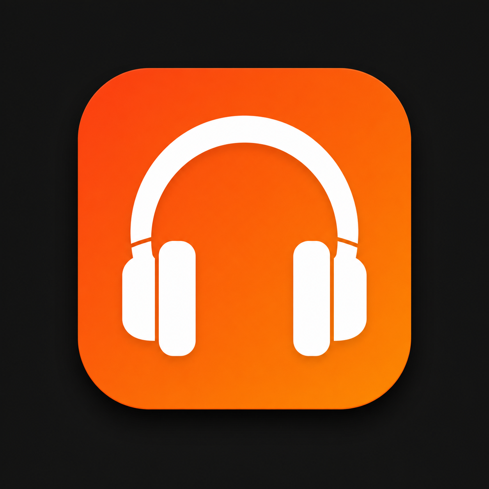

<p align="center">
  
</p>

# Spinback — Google Play Music revival

**Spinback** is an unofficial revival of **Google Play Music** (2011–2020),
built on the [Soniq Base Android](https://github.com/mob5824m-wq/Soniq-Base-Android)
framework. It brings back the orange, headphones-first music app — Listen Now
(Home), My Music (Library), Explore (Search), radio, offline downloads — as a
modern Android app (API 26+, zero runtime dependencies).

> **Unofficial tribute.** Google Play Music and Google Play are trademarks of
> Google LLC. This project is not affiliated with, sponsored by, or endorsed
> by Google. Google Play Music shut down in December 2020 and was replaced by
> YouTube Music; this revival uses the successor's public endpoints as its
> catalogue. See [`docs/GOOGLE-PLAY-MUSIC.md`](docs/GOOGLE-PLAY-MUSIC.md)
> for the full theme mapping and what is deliberately not replicated.


## What you get

- **Listen Now** — quick actions, Quick picks, Recently played,
  Continue listening.
- **Explore** — songs, artists, albums, playlists with history.
- **My Music** — liked songs, saved artists/albums, local
  playlists, downloads. All on-device; no account, no cloud.
- **Full player** — artwork, scrubber, synced lyrics (tap a line to seek),
  like, download, queue, radio; shuffle/repeat; up-next sheet.
- **Offline** — downloads to `Music/Google Play Music` with progress and
  cancellation; offline tracks play without the network.
- **System integration** — foreground playback service, media session,
  lock-screen/Bluetooth/headset controls, media notification, audio focus,
  home-screen widget, Android Auto browse.
- **Settings** — stream quality target, sleep timer, equalizer presets,
  crossfade/gapless, Wi-Fi only, library order, search history, storage,
  notifications, opt-in ListenBrainz scrobbling, Year in review.

## How it works

```
app/  (com.spinback.gplaymusic)          soniq-base/  (com.soniq.base)
  SpinbackApp ──► SoniqApp                PlaybackService · MediaSession
  GooglePlayMusicProvider ──► MusicProvider SPI
    └─► YouTubeMusicApi ──► InnerTubeClient   Library · Downloads · Lyrics
        (public endpoints only)               ListenBrainz · Widget · Auto
```

The framework (`:soniq-base`, vendored from Soniq Base Android, MIT) ships
playback, queue, library, downloads, lyrics, scrobbling and the complete UI
behind one small interface, `MusicProvider`. The app implements that
interface for its catalogue and extends `SoniqApp` + `MusicActivity` — the
same split as the Soniq Base reference app, customized with light surfaces,
Google Play Music-inspired orange accents and familiar navigation labels.
The vendored playback position tracker includes the upstream seek and buffering
fix from Soniq Base commit `8f272098`.

## Build

```bash
./gradlew :soniq-base:assembleDebug   # library AAR
./gradlew :app:assembleDebug          # debug APK
./gradlew :app:assembleRelease        # release APK (debug-signed, R8)
./gradlew :soniq-base:testDebugUnitTest
ANDROID_HOME=~/Android/Sdk python3 scripts/compile-check.py --tests
```

Requires JDK 17 and an Android SDK with platform 35. The Gradle wrapper pins
Gradle 8.9 and AGP 8.7.3. Module versions are derived from git — the latest
`vX.Y.Z` tag, or `X.Y.Z-SNAPSHOT` on later commits — so there is no version
number to bump by hand.

No APK or AAR is committed to the repository. Build with the commands above,
or download the `spinback-google-play-music-debug` /
`soniq-base-debug-aar` artifacts from the GitHub Actions **Build** workflow.

## Releases

A release is a `vX.Y.Z` tag on `main` plus a `CHANGELOG.md` section — nothing
else. Pushing the tag runs `.github/workflows/release.yml`, which builds and
tests both modules and creates the GitHub Release with
`spinback-google-play-music-<version>-release.apk` (plus the library AAR and
sources JAR) attached. Versions come from git tags, so the tag *is* the
version bump (`versionName` and `versionCode` are derived from it).

Three ways to cut one:

```bash
# 1. Manual (from a clean checkout of main):
python3 scripts/release.py 0.2.0            # validate and show the plan (dry run)
python3 scripts/release.py 0.2.0 --yes      # commit the changelog, tag v0.2.0, push both

# 2. Auto-bump (no version to type):
python3 scripts/release.py --bump patch     # dry run: next patch from the latest tag
python3 scripts/release.py --bump patch --yes
```

Or without a local checkout: **Actions → Release → Run workflow** and pick
`patch` / `minor` / `major` — the workflow bumps, tags, builds and publishes
the APK for you. Pushing to `main` with `[release]` in the commit message
(`[release:minor]` / `[release:major]` for a bigger bump) does the same
automatically; ordinary commits never cut a version.

Add entries under `## [Unreleased]` in `CHANGELOG.md` as you go (or pass
`--notes "…"`); the script moves them into the new version's section and the
Release workflow uses them as the GitHub Release notes. A `-rc.1`-style
suffix (e.g. `v0.2.0-rc.1`) becomes a pre-release.

## Docs

- [`docs/GOOGLE-PLAY-MUSIC.md`](docs/GOOGLE-PLAY-MUSIC.md) — theme mapping:
  what Google Play Music had, what this app does, what it does not claim.
- [`docs/REQUIRED-FEATURES.md`](docs/REQUIRED-FEATURES.md) — framework-wide
  requirements every Soniq app must meet (vendored from Soniq Base).
- [`docs/WIDGETS.md`](docs/WIDGETS.md) — widget and Android Auto contract
  (vendored from Soniq Base).

## License

MIT (see [`LICENSE`](LICENSE)). The vendored `:soniq-base` framework
originates in [Soniq-Base-Android](https://github.com/mob5824m-wq/Soniq-Base-Android)
(MIT); keep its copyright notice when redistributing.
